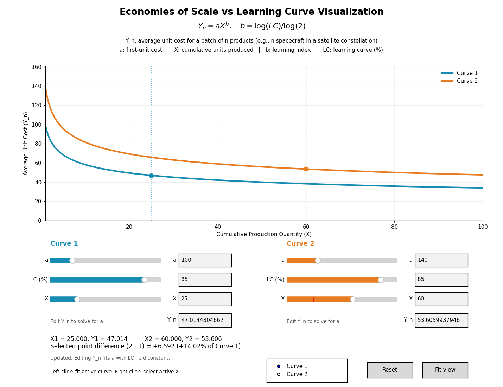

# Economies of Scale vs Learning Curve Visualization

A desktop Python tool for comparing two independently editable learning curves.

The visualization uses the learning-curve equation below. It does not add a separate economies-of-scale or diseconomies-of-scale term.



The original equation:

`Y_n = a * X**b`, where `b = log(LC) / log(2)`.

- **Y (Y_n):** average unit cost of producing a product batch of size n, such as a satellite constellation made of n spacecraft.
- **a:** cost of creating the first production unit.
- **X:** cumulative number of units produced.
- **b:** index of learning, `log(LC) / log(2)`.
- **LC:** learning curve expressed as a percentage in the controls; for example, enter `80` for 80%. The formula uses the fraction `0.80`.

For the aircraft example, LC=80% means the modeled average unit cost falls by 20% each time cumulative production doubles.

This is the cumulative-average interpretation of the equation: for a first batch of n units, X=n. For a later batch after previous production, the cost of that batch requires the difference between cumulative total costs, rather than simply treating X as the new batch size.

Both curves update immediately. Each has its own `a`, `LC`, and independently selected `X`. Set both X values equal for a comparison at the same production quantity, or choose different quantities for different scenarios. The readout labels X1, Y1, X2, and Y2 and shows the selected-point cost difference, including the percentage relative to Curve 1. When X1 and X2 differ, this compares costs at different production quantities.

## Install and run

Requires Python 3.10 or newer and a graphical desktop on Windows, macOS, or Linux. Download this repository (GitHub: **Code > Download ZIP**) and extract it. Open a terminal in the extracted folder containing `test.py` and `requirements.txt`.

### Windows (PowerShell or Command Prompt)

Install Python from https://www.python.org/downloads/ if needed. Then run:

```powershell
py -m venv .venv
.venv\Scripts\python.exe -m pip install -r requirements.txt
.venv\Scripts\python.exe test.py
```

If `py` is unavailable but `python --version` works, substitute `python` for `py` in the first command. Virtual environment activation is not required.

### macOS / Linux

```bash
python3 -m venv .venv
.venv/bin/python -m pip install -r requirements.txt
.venv/bin/python test.py
```

On Linux, your distribution may require additional packages for virtual environments and a GUI backend (for example, `python3-venv` and `python3-tk` on Ubuntu/Debian). A remote server without a display cannot open the interactive window.

Once installed, rerun only the last command to launch again. Keep the window open while using the controls.

## Controls

- Move either curve's `a` or `LC` slider, or type in its matching box and press **Enter**.
- Change either curve's `X` using its own slider or text box and press **Enter**. Only that curve's marker moves; the other selection and both curves' parameters remain unchanged.
- Edit either `Y_n` box and press **Enter** to fit that curve's `a` to the requested cost at that curve's selected `X`, keeping its `LC` constant.
- Choose **Curve 1** or **Curve 2**, then left-click the plot to fit that curve through the clicked point with its `LC` held constant.
- Right-click the plot to select the active curve's `X` without changing either curve.
- **Reset** restores both curves and their selected quantities. **Fit view** restores the plot limits to fit the current curves. The Y-axis otherwise only expands when needed, keeping parameter changes visible.
- Use the Matplotlib toolbar to save an image or zoom/pan. Plot fitting is disabled while toolbar zoom/pan is active.

Allowed input ranges: `1 <= a <= 500`, `1% <= LC <= 100%`, and `1 <= X <= 100`. Invalid values leave the current model unchanged and show an explanation. These ranges can be changed in the constants at the top of `test.py`.

`a` is the cost at X=1. `LC` is the factor applied to cost whenever cumulative production doubles. For example, LC=85% means Y(2X)=0.85*Y(X). LC=100% produces a flat curve. `Y_n` is calculated from the other inputs; editing it solves for `a`. A single clicked point cannot uniquely determine both `a` and `LC`.

## Portability and verification

The program contains no machine-specific paths and does not force a platform-specific GUI backend. It uses NumPy and Matplotlib, which provide packages for Windows, macOS, and Linux. Python and the dependencies must be installed; this repository is not a standalone executable.

Behavioral checks were run on macOS with Python 3.11, NumPy 1.26.4 and Matplotlib 3.7.1 using a noninteractive rendering backend. Native Windows and Linux GUI behavior has not been tested here.

Run the included checks with the same Python interpreter used to launch the app:

```bash
python -m unittest discover -s tests
```

